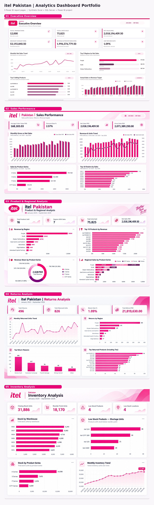
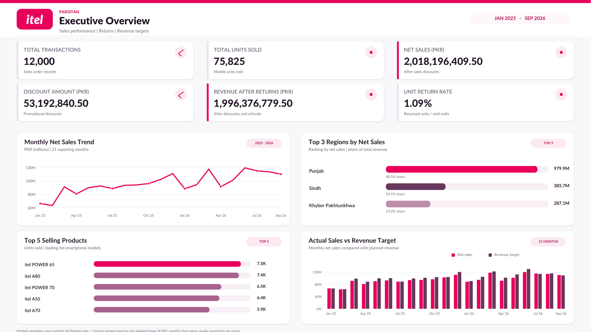
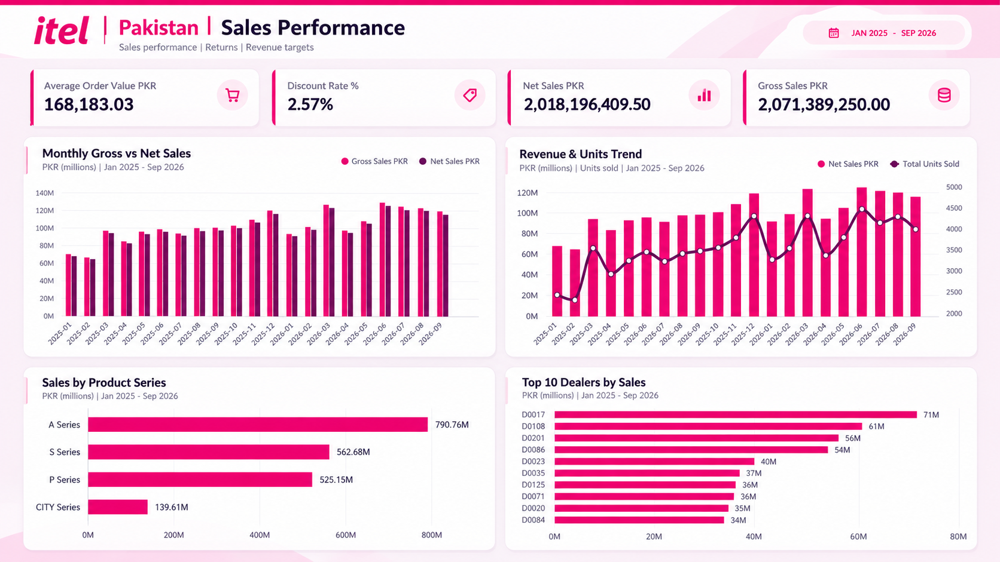
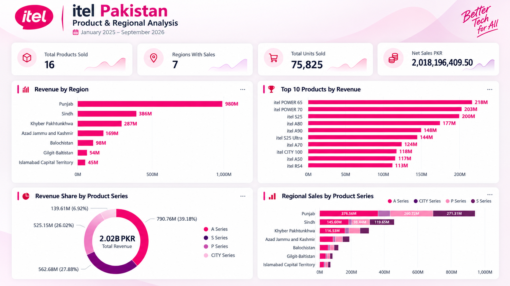
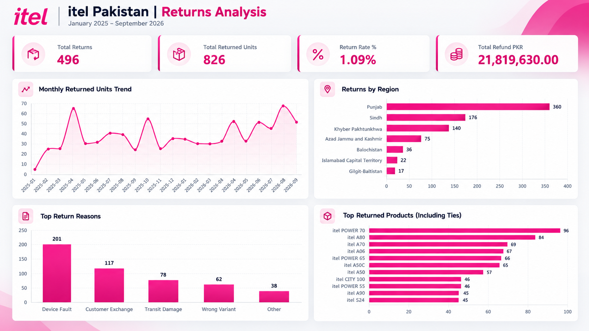
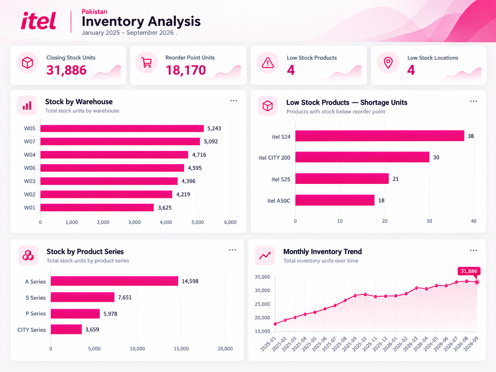
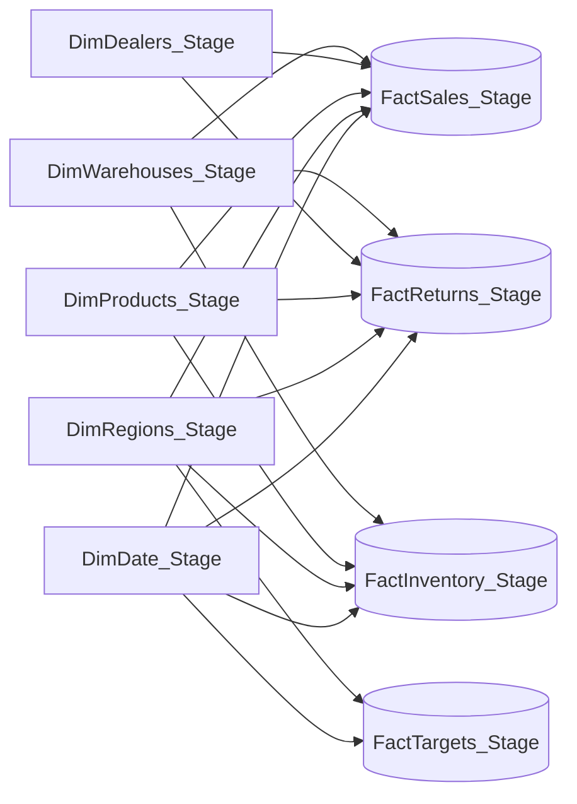

# itel Pakistan | Sales & Operations Analytics

**End-to-End Data Analytics Portfolio Project | Excel • SQL Server • Power BI**

[View the GitHub repository](https://github.com/khurraminsights/itel-Pakistan-Analytics) · [Dashboard gallery](#dashboard-gallery) · [SQL files](#sql-transformation-and-validation) · [Power BI model & DAX](#dax-and-metric-definitions)

A five-page analytics solution built around a **fully synthetic** smartphone sales and distribution dataset. This case study demonstrates relational data preparation, SQL-based quality controls, dimensional modeling, DAX, dashboard development, and the translation of business questions into actionable reporting.

**Analysis period:** January 2025 – September 2026 (21 months) · **Currency:** Pakistani Rupee (PKR) · **Reporting grain:** Sales, returns, and targets are transactional/monthly; inventory is a monthly snapshot.

> [!IMPORTANT]
> **Synthetic dataset / independent portfolio project.** All commercial figures, dealers, warehouses, transactions, returns, inventory balances, and targets in this repository are simulated for learning and demonstration. **They are not actual itel Pakistan results or market statistics.** This project is not sponsored, endorsed by, or affiliated with itel. The brand/product names are used for illustrative portfolio context. No real customer records are used.

[](portfolio_showcase.png)

> **About the gallery:** The five individual images below are **itel-inspired branded design previews**, reconstructed from the working Power BI report, **not direct exports of a live `.pbix` report**. They communicate the report layout, key metrics, and visualization choices; for auditable interactive results, use the Power BI model and source data. The final interactive `.pbix` file is **not currently uploaded**. Add it to the repository (e.g., `itel_Pakistan_Analytics.pbix`) to make the live report model reproducible.

## Contents

- [Project objectives](#project-objectives)
- [Dashboard gallery](#dashboard-gallery)
- [Business results & insights](#business-results--insights)
- [Dataset & star schema](#dataset--star-schema)
- [SQL transformation and validation](#sql-transformation-and-validation)
- [DAX and metric definitions](#dax-and-metric-definitions)
- [Reproduce the project](#reproduce-the-project)
- [Repository structure](#repository-structure)
- [Limitations & future improvements](#limitations--future-improvements)

## Project objectives

The simulated business needs a single reporting layer to answer five management questions:

1. **Executive health:** What are net sales, volume, returns, and sales versus targets?
2. **Sales performance:** How do gross and net sales develop over time, and which dealers and series contribute most?
3. **Regional/product mix:** Which regions and phone models lead revenue and how does product mix vary geographically?
4. **Returns:** How many transactions/units are returned, what do refunds cost, and what are the reported reasons?
5. **Inventory:** What is the latest warehouse stock, and where is replenishment needed?

**Tools and techniques:** Excel/CSV source preparation; SQL Server staging, import and integrity checks; Power BI Import mode; one-to-many star-schema relationships; Power Query typing; DAX measures; interactive KPI cards, line/combo, clustered/stacked bar/column and donut visuals.

## Dashboard gallery

### 01 — Executive Overview

[](01_executive_overview.png)

**Purpose:** Business-level KPIs with monthly sales trend, top sales regions/models, and a comparison of actual net sales with synthetic targets. Featured indicators include **12,000** sales lines, **75,825** units, **PKR 2.018B** net sales (after discount), **1.09%** unit return rate, and **PKR 1.996B** revenue after refunds.

### 02 — Sales Performance

[](02_sales_performance.png)

**Purpose:** Analyze monthly **gross vs. net sales**, the combined **revenue and units trend**, revenue by product series, and the top 10 dealers. Includes average order value and effective discount-rate KPIs.

### 03 — Product & Regional Analysis

[](03_product_regional_analysis.png)

**Purpose:** Compare **all seven geographic regions**, top 10 models ranked by revenue, the revenue-share donut for product series, and the series mix within each region.

### 04 — Returns Analysis

[](04_returns_analysis.png)

**Purpose:** Investigate returned-unit trends, returns by region, reasons for returns, and models with the most returned units. The product ranking includes a tie at the cutoff; **11 models may appear in a Top 10 filter** when ranks tie.

### 05 — Inventory Analysis

[](05_inventory_analysis.png)

**Purpose:** Monitor latest month-end stock by warehouse and series, identify individual low-stock models and unit shortages, and track **historical month-end closing stock** without adding stock from multiple months.

## Business results & insights

The following values were reconciled during the synthetic SQL/Power BI workflow. Figures displayed with `M`/`B` in dashboard mockups are abbreviated or rounded; SQL/Power BI source metrics are the reference for precision. They should be described as **results of the simulation**, not genuine corporate performance.

| Metric | Result | Meaning |
|---|---:|---|
| Sales transactions | **12,000** | FactSales records |
| Units sold | **75,825** | Sum of sold units |
| Gross sales | **PKR 2,071,389,250.00** | Before discounts |
| Discount amount | **PKR 53,192,840.50** | Discounts on sales lines |
| Net sales | **PKR 2,018,196,409.50** | Gross sales less discounts; **before refunds** |
| Return records | **496** | FactReturns records |
| Returned units | **826** | Sum of return quantities |
| Unit return rate | **1.09%** | Returned units ÷ sold units |
| Refunded amount | **PKR 21,819,630.00** | Return refunds |
| Revenue after returns | **PKR 1,996,376,779.50** | Net sales less refunds; **not profit** |
| Latest closing stock | **31,886 units** | Snapshot at **2026-09-30** |
| Sum of reorder points | **18,170 units** | Latest per-warehouse/product thresholds added |
| Low-stock products / affected pairs | **4 / 4** | Distinct products / warehouse-product combinations |
| Shortage below reorder points | **107 units** | Sum of positive shortages for affected pairs |

### Illustrative findings

- **Geographic concentration:** Punjab generated approximately **PKR 979.90M**, or **48.55%** of simulated net sales, followed by Sindh and Khyber Pakhtunkhwa. This suggests testing region diversification strategies within the simulated scenario—not making real market-share claims.
- **Product mix:** A Series contributed approximately **PKR 790.76M (39.18%)** of simulated net sales, the largest of the four series. The remaining shares were S Series **27.88%**, P Series **26.02%**, and CITY Series **6.92%**.
- **Model performance:** **itel POWER 65** led simulated units sold with **7,460 units**; it also ranked first by product revenue in the report (around **PKR 218M**). Revenue ranking and unit ranking are different business questions.
- **Return drivers:** **Device Fault** is the most frequent *recorded reason* (**201 of 496 cases**, about **40.5%**). This is a pattern in synthetic inputs, not evidence about actual device quality.
- **Stock action:** At the September 2026 snapshot, **four warehouse–product pairs** fell below their reorder points, with an aggregate shortage of **107 units**. These would be priority candidates for a simulated replenishment review.

## Dataset & star schema

### Nine SQL Server staging tables

| Table | Rows | Grain / primary role |
|---|---:|---|
| `DimDate_Stage` | 638 | One day per row, 2025-01-01 → 2026-09-30 |
| `DimRegions_Stage` | 7 | One region |
| `DimProducts_Stage` | 16 | One phone product/model |
| `DimDealers_Stage` | 211 | One simulated dealer |
| `DimWarehouses_Stage` | 7 | One regional warehouse |
| `FactSales_Stage` | 12,000 | One sales transaction line |
| `FactReturns_Stage` | 496 | One returned sale line |
| `FactInventory_Stage` | 2,030 | One product–warehouse–month-end stock snapshot |
| `FactTargets_Stage` | 147 | One region–calendar-month target (7 × 21) |

Five conformed dimensions filter four fact tables through **16 active, one-to-many, single-direction relationships**. There is **no direct fact-to-fact relationship** in the reporting model.



**Relationship counts:** 5 → Sales; 5 → Returns; 4 → Inventory; 2 → Targets. See [`relationships_16_active_single.csv`](relationships_16_active_single.csv) for all sixteen exact key pairs.

**Date handling:** `DimDate_Stage[Date]` is the marked date column. It connects to Sales[OrderDate], Returns[ReturnDate], Inventory[SnapshotDate], and Targets[MonthStart]. Target data is *monthly*, so monthly comparisons should use `YearMonth` (not interpret the target as a daily amount).

## SQL transformation and validation

The workflow loaded nine CSV sources into SQL Server, corrected source typing and date attributes, checked unique identifiers and foreign keys, and reconciled sales, return, inventory, and target logic before importing the staged tables into Power BI.

**Validation examples:**

- All **12,000** sales lines have valid dimension IDs and positive sales quantities; gross, discount and net sales were reconciled.
- The **496** return records were checked against their original sales for identifiers, return quantities, refund amounts and dates.
- All **2,030** inventory rows passed the stock equation:

  `Closing Stock = Opening Stock + Received − Sold + Restocked Returns`

- **147** region-month targets form a complete **7 × 21** grid.
- `DimDate_Stage[MonthStart]` was fixed in the working staging model to the first day of the associated month; the corrected date dimension was revalidated before date-table marking.

Files: [`01_create_and_load_stage_tables.sql`](01_create_and_load_stage_tables.sql), [`02_validate_stage_tables.sql`](02_validate_stage_tables.sql).

## DAX and metric definitions

Actual measures used in the five-page report are documented in [`dax_measures.dax`](dax_measures.dax) (enter them **one at a time** using **Modeling → New measure**).

**Sales and return logic:**

```dax
Gross Sales PKR =
SUMX('FactSales_Stage', ROUND('FactSales_Stage'[UnitsSold] * 'FactSales_Stage'[UnitPricePKR], 2))

Discount Amount PKR =
SUMX('FactSales_Stage', ROUND('FactSales_Stage'[UnitsSold] * 'FactSales_Stage'[UnitPricePKR] * 'FactSales_Stage'[DiscountPct], 2))

Net Sales PKR = [Gross Sales PKR] - [Discount Amount PKR]

Return Rate % = DIVIDE([Total Returned Units], [Total Units Sold], 0)

Net Revenue After Returns PKR = [Net Sales PKR] - [Total Refund PKR]
```

**Inventory rule:** Stock levels are *semi-additive*: summing closing stock across warehouses at **one date** is valid, but summing all **21 months** is not. A latest-snapshot measure powers stock cards and category charts; a separate monthly-snapshot measure powers the time trend.

**Interpretation rule:** `Net Sales PKR` is after discounts but **before** refunds; `Net Revenue After Returns PKR` subtracts refund amounts. Neither includes operating costs/taxes, so it is **not net income or profit**. `Return Rate %` is **returned units / sold units** over the selected reporting slice, **not an original-sales-cohort return probability**.

## Reproduce the project

### Requirements

- Windows with **Power BI Desktop** (Import mode)
- **SQL Server 2019+** and SQL Server Management Studio (SSMS), or another suitable SQL Server import method
- Nine included synthetic `.csv` files in [``]()
- SQL Server account/service access to the CSV import folder

### A. Load the SQL tables

1. Download/clone this repository and place the **nine files from ``** in a folder readable by the SQL Server service, for example `C:\itel_pakistan_data\`.
2. Open [`01_create_and_load_stage_tables.sql`](01_create_and_load_stage_tables.sql) in SSMS.
3. Replace **all nine** example `BULK INSERT` paths with the path used on your SQL Server machine.
4. Run the script **once in a fresh environment**. It creates a separate reproduction database called `itel_Pakistan_Portfolio_Repro` containing `_Stage` tables. **Do not rerun it in an already-populated database** without adapting it; it does not perform a migration/upsert. The creator's working database was `itel_Pakistan_Analytics`.
5. Run [`02_validate_stage_tables.sql`](02_validate_stage_tables.sql) and confirm the expected sales, return, inventory, and target totals.

> If SQL Server cannot read local CSVs via `BULK INSERT`, use **Import Flat File** (or your organization's permitted ETL method), keep IDs typed as **Text** and dates as **Date**, then recreate the same `_Stage` table names/keys before connecting Power BI.

### B. Configure Power BI

1. **Get Data → SQL Server** → use the SQL Server instance and the `itel_Pakistan_Portfolio_Repro` database (or your working `itel_Pakistan_Analytics` database).
2. Import the **nine `_Stage` tables**. Do not mix duplicate base/non-stage tables into the final model.
3. Verify ID columns are **Text**, dates are **Date**, quantity columns are **Whole number**, and prices, discounts and refunds are **Decimal / Fixed decimal** as appropriate.
4. Mark `DimDate_Stage` as the **Date table**, choosing `[Date]` (not `[MonthStart]`). Disable automatic date tables if necessary.
5. Create all **16** active, dimension-to-fact `1:*`, **Single** cross-filter relationships using [`relationships_16_active_single.csv`](relationships_16_active_single.csv).
6. Add the [`dax_measures.dax`](dax_measures.dax) expressions **as individual measures**; apply currency and percentage formats.
7. Rebuild the five report pages following the visual gallery, or open the `.pbix` separately if available. A finished `.pbix` is **not included** here.
8. Optional: **View → Themes → Browse for themes** and select [`itel_powerbi_theme.json`](itel_powerbi_theme.json).

### C. Confirm output

With no page/report filters applied, check that sales transactions equal **12,000**, net sales equal **PKR 2,018,196,409.50**, returned units equal **826**, and the latest inventory stock is **31,886**. Verify the 21-month chronology and model relationships, then check slicer behavior across visuals. Historical closing stock must be computed by **monthly snapshot**, not by adding all months. Revenue targets are keyed to the first day of each month, so compare against sales at the **month and region** level.

## Repository structure

All files currently sit in the **repository root**; there are no `assets/`, `sql/`, `data/`, `powerbi/`, or `docs/` subfolders. This is the structure verified for `main`:

```text
itel-Pakistan-Analytics/
├── README.md
├── .gitignore
├── portfolio_showcase.png
├── 01_executive_overview.png
├── 02_sales_performance.png
├── 03_product_regional_analysis.png
├── 04_returns_analysis.png
├── 05_inventory_analysis.png
├── 01_create_and_load_stage_tables.sql
├── 02_validate_stage_tables.sql
├── dax_measures.dax
├── relationships_16_active_single.csv
├── model_mermaid.mmd
├── itel_powerbi_theme.json
├── DimDate.csv
├── DimDealers.csv
├── DimProducts.csv
├── DimRegions.csv
├── DimWarehouses.csv
├── FactSales.csv
├── FactReturns.csv
├── FactInventory.csv
└── FactTargets.csv
```

**Navigation:** [SQL setup](01_create_and_load_stage_tables.sql) · [SQL checks](02_validate_stage_tables.sql) · [DAX measures](dax_measures.dax) · [16 relationships](relationships_16_active_single.csv) · [Star schema diagram source](model_mermaid.mmd) · [Power BI theme](itel_powerbi_theme.json) · [Synthetic CSVs](./)

> Dashboard PNGs are available directly above in the [gallery](#dashboard-gallery). No `.pbix` file is currently present in the repository; README images alone are not an interactive Power BI report.

## Limitations & future improvements

- **Branding and data ethics:** This is independently made with fictional commercial data and itel-inspired dashboard colors; it is **not** a real-world business performance report or an official itel design template.
- **Dashboard images:** The portfolio images are itel-inspired presentation mockups, not proof of an interactive report. The creator also built a five-page Power BI report in Desktop; add authentic Power BI exports and the `.pbix` file to verify the live report's measures and interactions.
- **Returns:** ReturnDate drives returns trends while OrderDate drives sales; slicing both by a month does not reconstruct a sale-cohort return rate. A cohort model would require an explicit sold-date-based analysis.
- **Targets:** Synthetic targets are for comparison exercises, not independent forecasts. Evaluate at **month × region** grain.
- **Inventory:** Snapshot stock is not additive over time; individual replenishment decisions depend on warehouse–product level thresholds and realistic lead times.
- **Recommended follow-ups:** Cross-page slicer validation, bookmark navigation, report-level QA, refresh workflow, live demo video, and an optional downloadable Power BI template/report.

---

**Portfolio case study:** Demonstrating practical data ingestion, SQL quality assurance, dimensional modeling, DAX, and multi-page dashboard storytelling using **synthetic** Pakistan smartphone distribution data.


